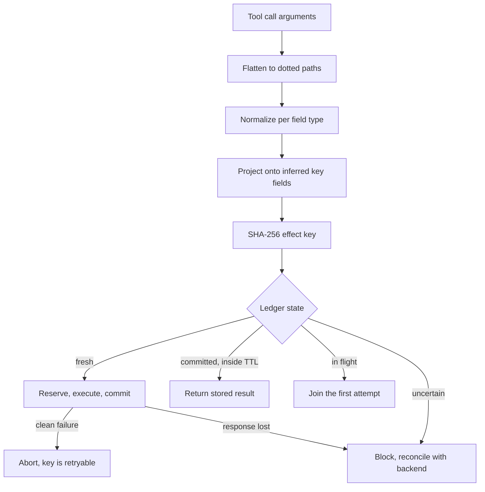
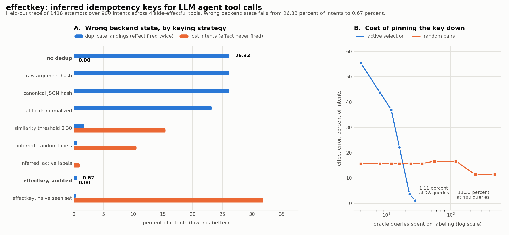

# effectkey

Infer which tool-argument fields actually determine a side effect, by solving a minimum hitting set over a pair-labeled call log, so an LLM agent's retries deduplicate without suppressing genuinely distinct calls.

## The problem

An agent calls `send_invoice`. The gateway accepts it, the backend issues the invoice, and the response is lost on the way back. The agent sees a timeout, concludes the call failed, and reissues it.

It does not reissue the same bytes. Models do not repeat themselves. The second attempt reorders the JSON keys, writes `$1,200.00` where it wrote `1200`, turns `2026-10-03` into `Oct 3, 2026`, rewords the note, and drops an optional field it bothered with the first time. Every one of those rewrites changes the hash of the request. None of them changes what the backend will do.

So the standard defense fails. An idempotency key works when the caller supplies a stable one, and here the caller is a language model that regenerates its arguments from scratch on every attempt. Hashing the arguments instead does not help:

- hashing the raw argument object is defeated by key reordering alone;
- hashing canonical JSON is defeated by value formatting;
- hashing every field after normalizing values is defeated by the agent rewording the invoice note, a field the backend never reads.

Loosening the comparison instead of tightening it fails in the other direction. Two calls that differ only in the invoice number are almost byte-identical, so any similarity threshold low enough to catch the rewrites is also low enough to swallow the second invoice. One failure mode is a customer charged twice. The other is a customer never charged. Both are real, and a dedup layer has to be scored on both at once.

## What this does

`effectkey` infers, per tool, the set of argument fields the backend's effect actually depends on, and keys on a canonicalized projection onto only those fields.

The field set is recovered from pair labels, which is the evidence production already produces: a backend conflict response, a reconciliation query, or an operator marking a duplicate incident. Two kinds of pair, two kinds of constraint:

- a **SAME** pair (one effect, two calls) cannot differ anywhere inside the key, so every field it differs on is forbidden;
- a **DISTINCT** pair (two effects) must differ somewhere inside the key, or the key merges them and the second side effect is suppressed.

The first rule gives an upper bound on the key. The second is a hitting set constraint. The smallest field set satisfying all of them is a constrained minimum hitting set, solved exactly by branch and bound, with ties broken toward the fields the agent rewrites least.

Around that sit the three parts that make it work in practice:

- **Active pair selection.** Randomly chosen pairs underdetermine the key badly, and the package measures how badly. The decisive pair is the near miss, two calls differing in exactly one field, whose label resolves that field outright.
- **An audit with repair.** The inferred key is probed in both directions against the same oracle. A pair the key merges that the oracle calls distinct is a collision, direct proof the key is too small, and the repair re-admits the fewest fields needed to fix it.
- **A write-ahead effect ledger.** Reserve, commit, abort, TTL, and an explicit uncertain state, because a key alone is not enough: a call that failed cleanly must stay retryable, and a call whose response was lost must not be retried blindly.

## Why this is interesting

Idempotency for agents is usually treated as an engineering chore, solved with a stricter hash or a fuzzier comparison. Neither works, because the question is not how to compare two calls. It is **which fields to compare**, and that is a property of the backend, not of the request.

Posing it that way turns a plumbing problem into a small, exact combinatorial one. "Which fields must the key contain" is minimum hitting set. "Which labels are worth paying for" is an active learning loop with a clean stopping condition: query until no pair can resolve another field. "Is this key actually right" is a two-sided audit whose failures carry their own repair. Minimality is not aesthetics here either: every extra field in the key is a field whose reformatting splits one intent into two keys and fires the side effect twice, so the smallest feasible key is the one that tolerates the most paraphrase.

The measured consequence is that the whole thing costs 28 oracle queries to pin down four tools, and that the same budget spent on random pairs leaves the key wrong.

## Architecture

FigJam board: https://www.figma.com/board/nNZHtyNWCHexyku093jpee

The diagram shows the two phases: an offline loop that turns a pair-labeled call log into an audited effect key per tool, and the runtime path where that key guards execution through the ledger.

Code-level flow of a single guarded call:



## Results



The metric is **wrong backend state**, as a percentage of intents, counted on a held-out trace of 1418 attempts across 900 intents and four side-effectful tools (`send_invoice`, `charge_card`, `create_shipment`, `post_message`). An intent is wrong in one of two ways: its side effect landed more than once (a duplicate), or it never landed because dedup suppressed the only attempt that would have worked (a loss). Both are reported, always together, because any strategy can drive one to zero by sacrificing the other.

| Strategy | Duplicates (%) | Lost (%) | Wrong state (%) |
|---|---|---|---|
| no dedup | 26.33 | 0.00 | **26.33** |
| raw argument hash | 26.33 | 0.00 | 26.33 |
| canonical JSON hash | 26.33 | 0.00 | 26.33 |
| all fields normalized | 23.33 | 0.00 | 23.33 |
| similarity threshold, tuned to 0.30 | 1.89 | 15.56 | 17.44 |
| inferred key, random labels (428 queries) | 0.67 | 10.67 | 11.33 |
| inferred key, active labels (28 queries) | 0.00 | 1.11 | 1.11 |
| **effectkey, audited (428 queries)** | 0.67 | 0.00 | **0.67** |
| effectkey key, naive seen-set guard | 0.44 | 32.00 | 32.44 |

Wrong backend state falls from **26.33 percent of intents to 0.67 percent, a factor of 39.5**, and the audited run recovers the true effect-field set exactly for 4 of 4 tools (mean Jaccard 1.000 against ground truth).

The baseline is no dedup at all, which is also exactly what raw and canonical hashing achieve: both dedupe zero calls on this trace, because key reordering defeats the first and value formatting defeats the second. Normalizing every field recovers only 3 points, since the agent rewords the human-facing fields. The tuned similarity threshold is the informative failure: swept on the training trace and then frozen, its best setting cuts duplicates to 1.89 percent but loses 15.56 percent of intents, which is the near-miss problem showing up as a number.

Panel B is the cost side. Active selection drops effect error from 55.6 percent to 1.11 percent in 28 oracle queries and then stops, because no remaining pair can resolve another field. Random pairs are still at 11.33 percent after 480. The last row is the mechanism ablation: the same correct key, guarded by the usual shortcut of recording the key before doing the work and never expiring it, loses 32 percent of intents, because a cleanly failed call can never be retried and a legitimate resend is suppressed forever.

### What is not claimed

- The workload is synthetic, generated by `effectkey/workload.py`. It is not rigged: the generator keeps a hidden semantic representation and emits a formatted wire representation, ground truth effect identity is computed from the semantic layer, and nothing in the dedup pipeline can see it. A normalizer that misses a formatting variant produces a counted duplicate.
- The residual 0.67 percent duplicate rate is real and is the method's ceiling. The generator abbreviates street addresses on retry (`Main Street` becomes `Main St`), which the backend treats as the same address and no generic canonicalizer can undo. Field-set inference fixes which fields matter, not value-level domain equivalence.
- The attempt stream is fixed before any strategy sees it, so every strategy replays identical input. That is conservative: a dedup layer returning a cached success would also cut the agent's retry loop short, so the measured benefit understates the real one.
- Two distinct intents carrying byte-identical effect values inside the dedup window are counted as correctly suppressed, not lost. No key-based scheme can separate them, which is what the TTL is for.

## How to run it

Python 3.9 or newer. The library itself is pure standard library; `matplotlib` is needed only to draw the benchmark figure and `pytest` only to run the tests.

```bash
git clone https://github.com/joelvarun/effectkey.git
cd effectkey
pip install -r requirements.txt
```

Run the demo, which issues one invoice twice and then fixes it:

```bash
python examples/demo_agent.py
```

Reproduce the benchmark and regenerate `docs/before_after.png`:

```bash
python bench/run_benchmark.py
```

Everything is seeded, so a rerun gives byte-identical results. It takes about a minute and also writes `bench/results.json` with the full per-tool breakdown, the audit trail, and the learning curve. Use `--intents` for a smaller or larger trace:

```bash
python bench/run_benchmark.py --intents 300
```

Run the tests:

```bash
python -m pytest tests/ -q
```

### Using it in an agent

```python
from effectkey import EffectLedger, infer_effect_keys

# calls: CallRecord(call_id, tool, args) from your tool-call log
# labels: PairLabel(a, b, same_effect) from backend conflicts or operator review
specs = infer_effect_keys(calls, labels)
ledger = EffectLedger(ttl_seconds=900)

spec = specs["send_invoice"]
with ledger.guard(spec.key(args)) as slot:
    if not slot.duplicate:
        slot.result = send_invoice(**args)
    result = slot.result
```

`guard` commits on clean exit, aborts on an ordinary exception so the call stays retryable, and parks the key as uncertain on a timeout so it is never blindly retried. `spec.explain(args)` returns the projection behind a key, which is what you want in an audit log when someone asks why two calls collapsed.

To spend a labeling budget well rather than labeling random pairs, use `select_labels_per_tool` with an oracle that answers "did these two calls produce the same effect", then audit the result with `verify_and_repair`.

## Example outputs

`python examples/demo_agent.py`, trimmed to the parts that matter:

```
Run 1: the agent retries a call whose response was lost
  attempt 1 raised TimeoutError: gateway closed the connection after accept
  the agent concludes the call failed and rewrites it
  attempt 2 returned {'invoice_id': 'srv-2'}

  invoices actually issued: 2
    1. 'INV-10432' for 1200
    2. ' INV-10432 ' for '$1,200.00'
  the customer was invoiced twice for one intent

Inferred effect key for send_invoice
  key fields:     amount, customer.email, invoice_number
  ruled out:      customer.name, due_date, note
  proven minimum: True (lower bound 3, 1 search nodes)
  labels used:    3 same, 3 distinct

  key(attempt 1) = 1caafa894024bd4e
  key(attempt 2) = 1caafa894024bd4e
  identical:       True
  key(INV-10433) = 3f04b75ccf74f0be  (separate)

Run 2: same trace, guarded by the inferred key
  attempt 1: raised TimeoutError, key parked as uncertain
  attempt 2: blocked, effect key 1caafa894024 is unresolved from a previous
             attempt; reconcile with the backend before retrying

  reconciling the uncertain key against the backend
  attempt 3: deduped, returning the stored result {'invoice_id': 'srv-1'}
  new invoice INV-10433: executed, returned {'invoice_id': 'srv-2'}

  invoices actually issued: 2
    1. 'INV-10432' for 1200
    2. 'INV-10433' for 480
  ledger: {'executed': 2, 'deduped': 1, 'joined': 0, 'aborted': 0,
           'blocked_uncertain': 1, 'expired': 0}

  unguarded:  1 intent  -> 2 invoices issued (1 duplicate)
  guarded:    2 intents -> 2 invoices issued (INV-10432 once, INV-10433 once)
```

Note that attempt 2 is blocked rather than deduped. The first attempt's outcome was genuinely unknown, so the ledger refuses to guess in either direction and waits for reconciliation. Only after the backend confirms the invoice landed does attempt 3 collapse onto the stored result.

`python bench/run_benchmark.py`:

```
building workload (900 intents per split)
  train: 1426 attempts  test: 1418 attempts  tools: 4
inferring effect keys
  active selection: 28 oracle queries
  verification:     400 oracle queries
  random baseline:  428 oracle queries
  field set random_labels  exact 1/4  mean Jaccard 0.479
  field set active_labels  exact 3/4  mean Jaccard 0.938
  field set active_greedy  exact 3/4  mean Jaccard 0.938
  field set audited        exact 4/4  mean Jaccard 1.000

strategy                          dup %   lost %  error %
---------------------------------------------------------
no dedup                          26.33     0.00    26.33
raw argument hash                 26.33     0.00    26.33
canonical JSON hash               26.33     0.00    26.33
all fields normalized             23.33     0.00    23.33
similarity threshold 0.30          1.89    15.56    17.44
inferred, random labels            0.67    10.67    11.33
inferred, active labels            0.00     1.11     1.11
effectkey, audited                 0.67     0.00     0.67
effectkey, naive seen set          0.44    32.00    32.44
---------------------------------------------------------
effect error 26.33 -> 0.67 percent of intents (39.5x lower)
```

The inferred keys, from `bench/results.json`:

| Tool | Inferred key fields | Matches ground truth |
|---|---|---|
| `send_invoice` | `amount`, `customer.email`, `invoice_number` | yes |
| `charge_card` | `amount`, `card_token`, `currency` | yes |
| `create_shipment` | `address.line1`, `address.postal_code`, `carrier`, `order_id` | yes |
| `post_message` | `channel`, `text` | yes |

`create_shipment` is the interesting one. Active selection excluded `address.line1` early, because a SAME pair differed on it (the agent had abbreviated the street), and the field then looked irrelevant. The audit caught it: 3 of 40 merge probes turned out to be collisions, the repair re-admitted `address.line1` as the minimum fix, and the second audit round came back clean. Without the audit that key stays wrong and reports no conflicts while doing it, which is why the audit is not optional.

## Repository layout

```
effectkey/
  flatten.py      nested arguments to dotted field paths
  normalize.py    type-driven value canonicalization and type sniffing
  constraints.py  pair labels to a hitting set instance
  hittingset.py   greedy and exact branch-and-bound solvers
  infer.py        per-tool EffectKeySpec and key derivation
  active.py       decisive pair selection under a query budget
  verify.py       two-sided audit and minimum repair
  ledger.py       reserve, commit, abort, TTL, uncertain state
  baselines.py    the keying strategies being compared
  workload.py     synthetic agent trace with hidden ground truth
  metrics.py      trace replay and effect-level scoring
bench/            benchmark pipeline and figure generation
examples/         runnable demo
tests/            43 tests, including the solver against brute force
```

## License

MIT
